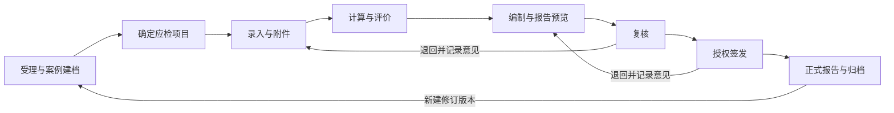

# 放射检测平台项目理解与实施方案

日期：2026年10月13日

本项目面向放射卫生检测机构，管理受理、现场检测、数据计算、结果评价、编制复核、授权签发和报告归档。建议在现有 Vue 3 与 Spring Boot 平台上完善 DR 和 CT 业务，先统一检测规则和正式报告模板，再补齐应检项目校验与审批控制。第一期的交付目标是：同一份原始记录能够得到可复算的结果、准确的适用性判定，并形成与批准内容一致的受控报告。

## 一 项目定位与范围

### 业务目标

检测人员目前需要在现场记录、Excel计算和Word报告之间重复整理数据。平台应将这些环节连在一起，减少重复输入，保留原始读数、检测条件、计算步骤、标准依据和审批记录。

项目涉及两条并行的专业业务：设备质量控制和场所卫生防护。两条业务分别计算和评价，最终汇入同一份检测报告。质量控制合格不能代替场所防护合格，场所防护合格也不能证明设备全部性能项目合格。

第一期建议覆盖普通诊断用 DR 和 CT，包含验收检测、状态检测和稳定性检测的适用性规则。每种检测类别单独验收。材料详细描述了DR和CT，但牙科机、DSA、乳腺DR、工业探伤、个人剂量监测主要出现在导航中，尚不足以形成各自完整的实施规格，应作为后续独立业务包。

普通CT与牙科CBCT必须分开配置。WS 519—2019的适用范围不包含牙科等锥形束CT，不能把设备名称包含“CT”作为套用同一规则的条件。[国家卫健委发布的WS 519—2019](https://www.nhc.gov.cn/fzs/c100048/201901/dc052ba6f0b644869c21d3faa5c93cf6/files/1733124689011_58662.pdf)

### 材料与功能的对应关系

| 材料 | 对项目的作用 | 使用边界 |
| --- | --- | --- |
| 78页项目PPT | 页面流程、DR/CT录入字段、公式说明、评价、审核、签发及查询要求 | 是业务原型，示例数字和存在冲突的说明需核定 |
| DR检测报告 | 正式输出的封面、封二、通用项目、DR专用项目、防护结果、点位图和签名结构 | 占位模板中的示例数据不能作为原始检测记录 |
| CT检测报告 | CT报告的目标结构 | 混入DR示例内容，需先修正再作为受控模板 |
| 工作区DR/CT Excel样表 | 字段代码、原始值、中间值、最终结果和导入布局 | 部分公式与PPT及标准存在差异，不能整体照搬 |
| 工作区现有前后端 | 可复用的业务和技术基础 | 代码存在不等于已通过本次需求验收 |

PPT第3至51页主要描述DR业务，第52至77页描述CT业务，第78页描述综合查询。第9页列出DR应检项目及条件，第58页列出CT项目，第34至36页和第75至76页描述评价，第45至50页描述编制、复核、签发及退回，第51页规定报告编号和文件名。

## 二 材料中需要先解决的冲突

### CT模板的结果和标准要求混入DR内容

CT模板正文第1页将诊断床定位精度示例写成“0.8 kV”，并配上管电压偏离的要求。定位光精度示例使用“3.1 mmAl”，水CT值、均匀性和噪声部分也存在角度或长度单位错配。点位图仍标注DR设备和DR操作室。这些内容不能进入CT规则库或真实报告。

CT质量控制字段应分别使用mm、角度、mGy、HU、百分数、lp/cm等正确单位，按项目记录检测条件。报告模板保留机构格式，替换错误的项目内容与示例图。

### CT和DR防护控制值必须区分

CT模板防护表列出的“≤25 μSv/h”与GBZ 130—2020第6.3.1条不一致。该条对CT等设备机房外规定不大于2.5 μSv/h；对具有短时、高剂量率曝光摄影程序的DR等设备规定不大于25 μSv/h，超过时进一步评价机房外人员年有效剂量，不大于0.25 mSv。当前代码已经区分CT与DR的2.5和25控制值，但仍需统一模板、界面和评价文本。[国家卫健委发布的GBZ 130—2020](https://www.nhc.gov.cn/fzs/c100048/202004/c01e99c6492248e3bd3df2d44cd0eca8/files/1734000609429_10053.pdf)

DR超过25 μSv/h后，应显示“待年有效剂量评价”，记录工作负荷和评价参数及其来源。评价未完成时不得生成“全部符合”的结论；超过控制要求的已知结果仍应如实记录。

### PPT的CT倾角说明存在复制错误

第60页是CT扫描架倾角精度，但右侧说明仍使用100 kV分界、kV偏差和管电压控制要求。正确计算应按模体法或倾角仪法记录角度，按对应CT规则判定。WS 519—2019附录A列出验收检测倾角精度要求为±2°，状态和稳定性检测该项不开展。

### Excel公式存在不能直接迁移的问题

DR直接录入样表中，输出量线性公式使用类似`K/I*t`的表达式，和按管电流时间积归一化的`K/(I*t)`具有不同含义。样表的重复性公式混用原始读数与经过校准的均值；AEC相对偏差中还存在百分数存储、显示以及取最大绝对值口径需要统一的问题。

CT直接录入样表中，头部与体部CTDI换算写法不同。背景统计公式引用了带标签的行，与实际第6至10次读数所在行不一致。高对比分辨力同时出现“乘0.42”和“读数即结果”的两种描述。

处理方式是建立逐项规则核定表，明确标准条款、采集方法、单位、公式、精度、适用类别、厂家或模体参数和期望算例。由业务负责人核定后形成版本，不按材料的先后顺序或某个Excel现存结果自动选择正确口径。

## 三 现有系统的基础与缺口

现有前端采用Vue 3、TypeScript、Vite和Element Plus，后端采用Java 17、Spring Boot和JPA。数据库已有MySQL部署与H2单机部署设计。放射检测模块已包含案例、测量字段、防护点、附件、判定和报告实体，并提供录入、计算、Excel导入预检、审批、报告下载和创建修订版功能。

计算层已经按原始值、中间值和最终值分别存储，包含STP多模型拟合、响应均匀性、CTDI和年有效剂量计算。报告层保存了案例数据快照与文件哈希。这些能力应继续利用。

下表列出需要优先处理的静态实现问题。优先级表示实施顺序，具体影响应通过对应的回归算例和流程测试确认。

| 优先级 | 现状或问题 | 处理措施 |
| --- | --- | --- |
| P0 | 材料中的CT项目、单位和控制要求错配 | 先修正规则清单与CT模板，建立确认版本 |
| P0 | 计算循环跳过完全未录入项目，提交审核主要比较已录入项目与已有最终结果数量 | 用受控的应检清单检查所有必检项目，漏检单独阻止提交 |
| P0 | 保存修改后的原始值未同步使已有计算结果失效，状态可继续保持已计算 | 输入版本变更后标记计算过期，重新计算成功前禁止提交 |
| P0 | CTDI计算无条件读取头模与体模数据 | 按检测类别选择分组，CT状态检测只要求应检的头模数据 |
| P0 | CT噪声和低对比使用通用上限比较，高对比使用通用下限比较 | 区分严格小于与小于等于、严格大于与大于等于，增加边界测试 |
| P0 | 稳定性项目部分仍使用状态检测的固定阈值，或未完成基线比较 | 单独实现稳定性适用矩阵及基线差值判定 |
| P0 | 报告编号目前拼接案例编号和生成日期 | 按PPT要求以受理编号作为报告编号，修订版本另行管理 |
| P0 | 当前报告由代码新建通用Word，缺少正式封二和目标五列表结构 | 改成机构受控模板，保留封面、正文、签名和正文页码规则 |
| P1 | 现有工作流提供提交、通过、批准和修订，缺少普通退回修改接口 | 增加复核和签发退回，保留意见、责任人、时间及再次提交记录 |
| P1 | 标准规则维护表与实际硬编码评价逻辑尚未形成统一执行来源 | 让发布后的规则版本驱动实际评价，并以案例快照锁定版本 |
| P1 | 防护字段缺少完整的响应时间修正和本底处理分支 | 分离仪器校准因子、单位换算、响应时间及本底策略 |
| P1 | 查询主要按案例编号、设备类别和状态过滤 | 补充单位、设备编号、年份、日期范围和地区条件 |

主要改造位置为：[计算服务](S:/codex/bhfyzx/ohdp-api/src/main/java/com/dsf/radiology/service/RadiologyCalculationEngine.java)、[判定服务](S:/codex/bhfyzx/ohdp-api/src/main/java/com/dsf/radiology/service/RadiologyStandardEvaluator.java)、[案例与流程服务](S:/codex/bhfyzx/ohdp-api/src/main/java/com/dsf/radiology/service/RadiologyCaseService.java)、[报告服务](S:/codex/bhfyzx/ohdp-api/src/main/java/com/dsf/radiology/service/RadiologyReportService.java)及[放射检测工作台](S:/codex/bhfyzx/ohdp-web/src/components/radiology/RadiologyWorkbench.vue)。

## 四 目标业务流程

一次检测以设备和检测类别形成案例。同一受理项目可关联多个设备案例，第一期默认每设备案例生成一份报告。受理编号、系统案例ID和内部报告ID分别管理，避免依赖一个字符串承担全部身份。若需要多设备合并报告，应另设报告批次，明确结果分组、编号和签发范围。

### 案例建档

建档沿用四步：受检单位、受检设备、检测机构及仪器、确认创建。单位、设备、仪器和标准从基础库选择，自动带入信息。案例保存所用资料的版本或快照，基础库后来修改时不改写历史检测信息。

增加或明确受理编号、送检和委托单位、检测起止日期、地区、设备能力、模体型号、检测方法、执行标准及版本。仪器校准证书应按检测日期核验有效性，不能只按报告生成当天核验。多台仪器分别关联证书和用途。

### 应检项目确定

系统依据设备类型、检测类别、设备功能和方法条件建立应检清单。DR通用项目和DR专用项目分别组织，CT按11项质量控制项目组织，场所防护单独组织。

每个项目都要保留状态，不检测的项目仍在结果清单和报告中出现。“不适用”“未检测”“建立基线”“数据不完整”“待评价”不能混为同一个空值。

| 项目状态 | 业务含义 | 对提交的处理 |
| --- | --- | --- |
| 应检且未完成 | 适用且缺读数、条件或附件 | 阻止提交，指出缺失项 |
| 不适用 | 检测类别不开展，或设备不具备相应功能 | 记录理由和依据，经核对后可提交 |
| 条件不足未开展 | 如缺少符合方法要求的图像或条件 | 记录事实，按批准的检测范围和受控例外流程处理 |
| 建立基线 | 本次结果作为后续比较参考 | 明确基线状态和建立条件，不自动标为合格 |
| 待专业评价 | 有结果但缺少参考值、规则或年剂量评价 | 完成评价或执行受控的限定报告流程后再提交 |
| 符合或不符合 | 结果已具备判定条件 | 均可进入报告复核，结论必须如实保留 |

不符合结果本身不应阻止出具报告。系统需要阻止的是漏检、过期计算、未经确认的评价或被擅自改写的结论。

### 复核与签发

编制人员提交时生成待复核快照。复核人员查看原始记录、计算步骤、依据和同一版报告预览，可通过或退回。授权签字人确认本次批准的内容及版本。退回后重新计算或重新排版时产生新版本，重新经过审批。

登录用户ID是流程操作人的权威身份，不能仅依赖前端填写的姓名决定谁复核或签发。角色负责控制创建、修改、复核、签发、归档与规则发布权限，具体人员资格和职责分离规则按机构制度配置。

批准后冻结数据、规则、模板、结论、附件和签字信息。生成最终报告只能读取该批准快照，不能在出报告时重新读取最新规则并改变结论。历史报告保留版本关系，修订后明确原件状态和替代关系。

## 五 功能模块设计

| 模块 | 第一阶段应具备的功能 |
| --- | --- |
| 工作台 | 我的待办、待录入、待复核、待签发、退回任务和证书到期提示 |
| 受理与案例 | 单位及设备建档、四步向导、草稿恢复、检测范围和应检项目 |
| 检测录入 | DR/CT专用表格、分组条件、动态重复读数、键盘连续录入、字段校验 |
| 数据导入 | 模板下载、格式版本识别、字段映射、预检、差异确认、事务导入 |
| 计算评价 | 中间步骤、精度规则、标准条款、基线比较和不符合项汇总 |
| 场所防护 | 本底、点位读数、修正分支、点位图关联、DR年有效剂量评价 |
| 报告中心 | 草稿预览、编制复核、签发、正式Word、可选PDF、修订记录 |
| 基础资料 | 单位、地区、受检设备、检测仪器、证书、模体、人员、标准和模板 |
| 综合查询 | 年份、日期范围、地区、单位、设备类型、设备编号及报告状态检索 |
| 系统管理 | 用户角色、数据范围、操作记录、备份恢复和版本发布 |

页面保留PPT的五步主流程。录入界面按项目分组显示，原始值可编辑，计算值只读，错误定位到具体字段。颜色可以辅助区分，但状态必须有文本。报告预览直接显示生成文档的页面，避免网页评价表与Word版式各自计算或排版。

对原型中的“记住密码”，建议实现为受控的保持登录，凭据不以明文保存在浏览器。草稿按用户和案例隔离，并注明本机草稿与已提交数据的区别。

## 六 计算与判定设计

### 受控规则的结构

每条规则至少记录设备类型、项目代码、检测类别、方法、适用条件、输入字段、单位、公式标识、计算版本、修约规则、比较运算符、阈值、标准条款、启用日期和发布人。厂家要求、模体参数、设备基线有自己的来源和有效条件，检测案例引用确定的版本。

阈值和适用条件可以配置，复杂公式采用经过测试的服务实现。规则维护页面的修改应先保存为草稿，验证算例通过并批准发布后才参与新检测。仅保存“规则版本”字符串不足以复算历史结果，还应保留公式实现的发布标识和完整参数。

通用的数值上限不足以描述全部判定。规则需明确`<`、`≤`、`>`、`≥`、绝对偏差、相对偏差、基线变化、定性判断及不适用分支。边界值不能靠浮点容差统一放宽。

### 原始精度与显示精度

按PPT要求采用“四舍六入五留双”，即HALF_EVEN修约。每个项目单独定义原始有效数字、中间步骤修约和最终结果显示位数。现有实现部分结果保留2位，而PPT要求1位，CTDI中间值精度也需核定。

不能统一在每一步先修约，也不能统一只在最终一步修约。应按核定的检测方法确定计算精度以及判定采用的数值口径，并在规则版本内保存。原始记录、计算值和报告展示值分别保留，确保报告所示结论可以解释。

线性运算、单位换算和十进制比较优先使用十进制数。回归、对数、幂及反三角计算使用受测数值实现，并用独立算例验证精度和定义域。零分母、非正对数输入、无效反函数、重复的拟合自变量都应给出具体错误。

### DR质量控制

DR通用项目为：管电压指示偏离、辐射输出量重复性、输出量线性、半值层、曝光时间偏离、AEC重复性、AEC响应、AEC电离室一致性、线束垂直度和光野照射野四边偏离。DR专用项目为：DDI、STP、响应均匀性、测距误差、残影、伪影、高对比度分辨力和低对比度分辨力。

| 重点项目 | 计算与采集要求 | 需要控制的分支 |
| --- | --- | --- |
| 管电压偏离 | 每组保存预设值、3次读数和校准因子，保留绝对及相对偏差 | 报告按规定显示kV或百分数，判定按对应允许偏差 |
| 重复性 | 保存5次读数、均值、样本标准差和CV | 同一校准因子处理要一致，不能将校准均值和未校准离差混算 |
| 输出量线性 | 先按每组管电流时间积归一化，再比较组间线性 | 校对括号、时间单位和百分数倍数 |
| AEC项目 | 保存设备是否具备AEC及其测量方式 | 不具备AEC时记录不检测原因，不能作为缺数据 |
| DDI | 保存厂家公式或参考值、基线及实测平均值 | 初次建立基线与使用既有基线分开处理 |
| STP与均匀性 | 5档剂量与像素值拟合，保存模型、系数、R²和逆变换结果 | 均匀性使用同一受控模型，明确幂模型是否含常数项 |
| 残影与伪影 | 定性结果、相关ROI和图像证据 | 不具备检测条件与检测后结果为“无”必须分开 |
| 分辨力 | 原始读数、厂家要求、Nyquist参数或已批准基线 | 不能把缺参考值统一当作合格或不适用 |

各检测类别的应检与不检项目应按WS 76—2020的项目表逐条核定。原型中按设备条件跳过预处理图像项目的操作，要保留原因并进入报告复核。[国家卫健委发布的WS 76—2020](https://www.nhc.gov.cn/fzs/c100048/202011/f9805f07f68243c7bf01a209d5b60133/files/1734000631901_35064.pdf)

### CT质量控制

CT质量控制包括诊断床定位精度、定位光精度、扫描架倾角精度、重建层厚偏差、CTDIw、水CT值、均匀性、噪声、高对比分辨力、低对比可探测能力及CT值线性。

| 重点项目 | 应保存的结果与条件 | 实施要求 |
| --- | --- | --- |
| 诊断床 | 前进及归位起终点、指示距离、床面负重、两方向误差 | 不只保存最大值，报告保留定位和归位两行 |
| 扫描架倾角 | 检测方法、设定角、测量角、L1/L2及角度偏差 | 模体法采用角度几何关系，状态和稳定性按不检项说明 |
| CTDIw | 头模和体模分别记录中心及四周读数、层数、层厚、校准因子、厂家值或基线 | 分别计算与判定，不以头体模最大值替代全部结果 |
| 重建层厚 | 半高CT值、实测宽度、转换系数、实测层厚、标称层厚与偏差 | 0.42等系数只能来自对应模体和方法，不能作为普遍常数 |
| 定位光及高对比 | 采集值、单位、是否需要换算、方法及重建算法 | 已换算结果不重复乘系数，lp/cm与lp/mm明确转换 |
| 低对比 | 各标称对比度、可辨最小直径及乘积平均 | 孔径数量与直径映射属于模体资料，不作为通用标准常数 |
| 水CT值和均匀性 | 中心和四周ROI、扫描条件、基线及差值 | 稳定性评价使用基线变化，不能沿用状态固定限值 |
| 噪声 | ROI标准差、层厚、对比度标尺和归一化噪声 | 明确百分数倍数、10mm层厚归一化和严格边界 |
| CT值线性 | 模体材料、相应标称CT值和各次读数 | 材料标称值来自模体资料，按检测类别确定是否开展 |

WS 519—2019附录A明确，状态检测体部模体CTDIw不开展；常规算法高对比分辨力状态检测要求大于5.0 lp/cm，噪声小于0.45%，低对比可探测能力小于3.0 mm。上述三个边界值恰好等于阈值时均不能按“≤或≥”放行。稳定性中的水CT值、均匀性、噪声和CTDIw应比较基线，不能套用状态检测规则。[WS 519—2019附录A](https://www.nhc.gov.cn/fzs/c100048/201901/dc052ba6f0b644869c21d3faa5c93cf6/files/1733124689011_58662.pdf)

CTDI100的单位换算需依据仪器输出单位明确处理，例如mGy·cm与mm长度之间的转换。还应检查所用方法的适用范围，WS 519—2019中该定义公式注明N×T不大于40 mm的条件，超出条件应进入已核定的专用方法流程。

### 场所卫生防护

点位数量随现场变化，不能固定为模板的22个点或导入表的6组。每点保存编号、名称、空间位置、读数列表、单位、平均值、仪器、测量日期和修正方式。点位图中的编号应与结果表一致，附件归属于本案例及相应版本。

区分剂量与剂量率，区分空气比释动能与周围剂量当量率。mSv/h、μSv/h、nSv/h进入统一的μSv/h单位后计算；不能用无单位的`a`默认值隐含输入单位。校准因子来自对应仪器证书或方法文件。

GBZ 130—2020附录B区分不扣本底与扣本底处理。需要响应时间修正时，应采用相应扣本底处理分支，而非仅把结果乘一个系数再统一注明“未扣本底”。系统要分别存储本底10次读数、出束时间、仪器响应时间、校准因子k1和响应时间修正系数k2，并形成与实际处理一致的报告备注。[GBZ 130—2020附录B及附录D](https://www.nhc.gov.cn/fzs/c100048/202004/c01e99c6492248e3bd3df2d44cd0eca8/files/1734000609429_10053.pdf)

DR年有效剂量评价须把检测条件、工作负荷口径、使用因子、居留因子及其出处记录完整。当前代码采用100 mA归一化和年mAs换算，后续应由业务负责人核定其适用条件，再纳入受控方法。缺少评价输入时维持“待评价”，不能用未确认的默认值自动形成最终符合结论。

## 七 数据设计

保留现有`qc_inspection_case`、测量、点位、附件和报告实体，逐步增补结构。避免把检测条件、证书及审批历史长期压缩在自由文本里，也避免为每个设备类型复制一套相同业务表。

| 数据对象 | 核心字段或关联 | 作用 |
| --- | --- | --- |
| 受理项目 | 受理编号、委托及送检单位、检测范围、负责人员 | 组织一个或多个设备案例 |
| 设备检测案例 | 类型、设备资料、检测类别、起止日期、地区、状态、修订来源 | 承载具体检测流程 |
| 案例检测项目 | 项目代码、是否应检、不适用理由、检测分组、完成状态 | 对漏检与不检作明确区分 |
| 检测条件 | SID、kV、mA、mAs、曝光时间、重建算法、层厚、模体 | 自动生成报告中的条件列 |
| 原始测量 | 字段代码、数值或文本、单位、重复序号、采集或导入来源 | 保留可核验的原始证据 |
| 计算批次与结果 | 输入版本、计算版本、中间值、最终值、修约、判定及条款 | 防止使用过期结果并支持复算 |
| 设备基线 | 设备、项目、方法、条件、数值、来源报告、建立日期、批准状态 | 支持稳定性和后续状态检测 |
| 防护点位 | 编号、读数、单位、修正、结果、限值及年剂量参数 | 点位逐项判定与图表关联 |
| 仪器证书引用 | 仪器ID、证书版本、起止有效期、因子及方法适用范围 | 固化本次检测所用证书资料 |
| 审批记录 | 用户ID、角色、动作、前后状态、意见、时间、对象版本 | 完整保留提交、退回、复核和签发历史 |
| 模板与规则版本 | 版本标识、适用范围、发布日期、批准人、文件或定义哈希 | 控制执行和输出来源 |
| 报告及快照 | 受理编号、报告版本、批准快照、附件版本、生成文件哈希 | 实现批准内容与成品一致 |

案例至少有数据版本，计算结果引用该数据版本。更新读数、条件、基线或影响评价的参数时，数据版本递增，相关结果立即过期。提交时校验最新数据版本与计算版本一致。多人部署增加并发版本控制，避免两人编辑相互覆盖或重复签发。

历史数据迁移时，不给缺失的原始记录补造数值。标记其来源及资料完整性，保留已有报告和文件。新规则不自动改写既有结论，需要重新评价时创建新的计算或修订版本。

## 八 技术架构与部署

### 应用架构

沿用现有技术栈，采用按业务模块划分的单体应用。前端负责采集、预览及操作提示，后端统一完成计算、判定、审批校验和报告生成。手工录入与Excel导入调用同一校验和计算服务，避免出现两套结果。

建议分为案例服务、项目适用性服务、计算服务、标准评价服务、流程服务、报告服务和基础资料服务。复杂算法与模板生成可独立为内部模块，第一期无需增加微服务部署成本。

现有数据来源接口尽量兼容，新增版本、适用性、退回与报告预览接口。前端大型工作台逐步拆为案例向导、项目录入、结果评价、报告预览和审批组件，拆分同时保留原有接口行为。

### Excel导入

现有导入支持一案例一行数据和预检，第一期继续采用该方式，不能把“Excel批量导入”描述成已支持多案例批量创建。若业务需要多设备整批导入，应独立增加批次ID、逐行案例映射、失败处理和重复导入策略。

导入顺序为模板版本校验、字段识别、数值与单位校验、预检展示、差异确认、事务保存、计算评价。模板只接收原始输入，不采信上传表中的最终结果或公式缓存。导入文件保存来源哈希和批次，能定位到工作表及具体单元格。

模板应包含设备与项目关联信息、单位、条件、厂家参数或基线、点位名称等必要字段。未知列、重复字段、必填缺失、重复导入以及将空值覆盖已有值的行为都要明确告知。

### 部署方式

| 场景 | 建议方式 | 使用边界 |
| --- | --- | --- |
| 单人离线使用 | 现有Windows安装包与H2文件数据库 | 仅本机服务，备份数据库与附件及模板 |
| 机构多人协作 | 内网Web服务与MySQL，共用受控附件存储 | 统一数据源，服务端审批与并发控制 |
| 机构服务器部署 | 现有服务器或Docker部署方案 | 根据实际访问范围配置账户、备份和升级机制 |

第一期选择一个明确的协作模式。离线单机和多人平台之间的数据同步，涉及冲突、编号、签发版本和附件关系，若确有需要，应作为单独需求设计，不能直接复制数据库文件实现同步。

备份必须同时覆盖数据库、附件、模板、规则版本和已签发报告。安排在独立目录恢复一次并验证文件与记录对应关系，才能确认备份可用。升级保留旧报告和规则版本，失败可回滚应用及相应数据库变更。

### Git基线与实际运行状态（2026-10-13核查）

本次通过Git远端查询、服务器SSH、容器检查和HTTP请求核实状态。当前工作目录为`S:/codex/bhfyzx`，检出本地`test`分支，提交为`60e9242`；本地`main`也在该提交。GitHub仓库为`kevinelly/ohdp`，远端当前只有`main`分支，提交为`564bc63`。本地`test`比远端`main`领先23个提交，未设置上游，并存在未提交修改和未跟踪文件。当前源码不能仅用Git提交号完整描述。

| 部署对象 | 已核实状态 |
| --- | --- |
| 腾讯云访问地址 | `http://101.33.226.22:8088/`；首页和`/healthz`均返回200 |
| 当前服务器发布目录 | `/opt/bhfyzx/releases/release-20260917-manuals-1851`，由`/opt/bhfyzx/current`指向 |
| 线上镜像 | API为`bhfyzx-api:manuals-20260917-1851`；Web为`bhfyzx-web:manuals-20260917-1851`；数据库为`mysql:8.4` |
| 运行状态 | API、Web、MySQL三个容器均为`healthy`；容器内API文档端点可访问 |
| 端口与数据 | Web发布8088端口；API和MySQL未发布宿主机端口。数据库、报告、参考文档和放射附件分别挂载持久数据卷 |
| Windows单机安装版 | 本地已有`output/installers/BHFYZX-Setup-1.0.12-x64.exe`，采用Java 17、H2及本机浏览器服务；本次未启动或重新验收安装包 |
| Windows Docker版 | 已核对离线安装、升级及备份脚本；本机Docker Linux引擎当前不可连接，所查常用服务端口无监听，不能据此确认本机有运行实例 |

线上容器内`/app/app.jar`、当前发布目录的`app.jar`与本地`ohdp-api/target/ohdp-api-0.0.1-SNAPSHOT.jar`的SHA-256均为`82ee9ea527d484cf7bfd8b04c985d36bd7dc30c99495fd9643bf5ca4cdbea841`。这证明运行包与本地现有构建产物一致，不证明当前所有未提交源码都已构建并部署。当前线上发布目录未发现`release-manifest.json`，后续发布应补齐源码提交、工作区变更归档、构建时间和产物哈希，确保可重建和追溯。

本次未执行重新构建、Git推送、部署、服务重启、数据写入或备份恢复。上述状态核查不能替代放射模块的业务流程及报告成品验收。

## 九 正式报告方案

使用经机构核定的DR和CT两套DOCX模板。将现有DOC规范化转换一次，保留机构名称、受控表号、字体、页眉、封二、表格样式、签字和盖章位置。对CT模板中错配的项目、单位、要求与点位图先修正，经确认后发布模板版本。

| 报告部分 | 数据来源与排版要求 |
| --- | --- |
| 封面 | 受理编号、样品或设备名称、单位、委托或送检信息和检测类别 |
| 封二 | 机构核定的注意事项，作为受控静态内容 |
| 基本信息 | 设备及单位快照、日期范围、检测项目、标准和仪器证书 |
| 质量控制表 | 检测项目、检测条件、检测结果、标准要求、评价五列 |
| 防护表 | 点位序号、位置、结果、控制值、评价及相关备注 |
| 点位图 | 本次现场图，编号与点位表一致，大小和方向受控 |
| 总体评价 | 基于逐项结果形成建议文本，编制人员核对并纳入审批 |
| 签名和日期 | 编制、复核、授权签字人与批准版本关联 |
| 页码 | 按模板约定，正文页数排除封面及封二，动态计算 |

项目缺测或不适用时保留表格行和说明，不静默删掉。管电压多档、四边偏离、水平与垂直测距、CT头体模等分组按报告要求展开。不能把全部组结果压成一个最大值或长文本而丢失条件和对应评价。

报告编号按PPT第51页与受理编号一致。文件名采用其要求的“检测报告--受理编号[设备类型-受检单位名称].时间”规则，具体时间格式作为配置确定。内部ID、生成批次和修订号单独记录，以支持多次下载、重新生成及修订。

草稿报告带明显状态标识，可进入编制、复核和签发预览。批准后从相同快照生成正式文档。若增加PDF，PDF应由同一版DOCX转换得到，网页预览使用同一输出，不另外拼一个近似页面。Word或PDF实际签章方式按机构受控流程确定，普通姓名或签名图片不能自动代表完成电子签章。

报告模板验证至少覆盖长单位名称、多人及多台仪器、多个证书、30个以上点位、图片比例、跨页表头、正文页码、不符合项加粗、空值标记及最终签名页。当前样例都是7个物理页面，不代表所有真实报告必须固定7页。

## 十 分阶段实施

以下为在现有代码上推进的初步估算，假设配备1名后端、1名前端，测试人员和业务专家持续参与，仪器、模体及模板资料能及时提供。范围或资料变化后需重新估算，不能把表中的工期作为交付承诺。

| 阶段 | 主要工作 | 可评审成果 | 估算 |
| --- | --- | --- | --- |
| 0 规则与模板核定 | 逐项处理冲突，确定适用矩阵、精度、基线、条件和模板 | 规则确认表、字段字典、两套模板、标准算例 | 1至2周 |
| 1 数据与流程 | 项目状态、输入版本、结果失效、退回、身份及审批记录 | 可完整录入并退回重审的DR/CT案例 | 约2周 |
| 2 计算与报告 | 分类计算、边界判定、防护修正、正式模板、快照预览 | 与批准数据一致的DR和CT报告 | 约2周 |
| 3 验收与交付 | 人工算例对照、权限、导入、版式、部署及恢复验收 | 验收案例、问题记录、部署包和操作说明 | 1至2周 |

总体可先按6至8周安排评审窗口，规则确认较慢或验收与稳定性资料需补充时延长。优先交付DR与CT状态检测完整流程，再以独立验收案例开放验收检测与稳定性检测。未通过验收的类别应在产品中明确显示状态，不能以统一入口暗示全部已可使用。

牙科、DSA、乳腺DR后续复用共同的案例、审批和报告能力，并分别增加自己的采集及评价规则。工业探伤和个人剂量监测涉及不同对象、记录及报告，应独立分析。

## 十一 验收标准

### 业务和计算验收

每个质量控制项目使用经业务核定的标准算例。算例包含原始读数、条件、公式步骤、修约结果、标准条款及最终判定，不能只比较Excel的最终单元格。典型必测情形如下。

1. DR无AEC时正确保留三项不检测理由，无预处理图像时正确说明相应项目状态。
2. DR或CT漏填一个应检项目，即使其他项目计算成功，也不能提交审核。
3. 计算后修改读数、检测类别、模体参数或基线，必须重新计算，旧结果不得提交。
4. CT状态检测只录应检头模数据即可完成CTDI流程，不强制补体模。
5. CT状态噪声恰为0.45%、低对比恰为3.0 mm、高对比恰为5.0 lp/cm时，严格比较结果正确。
6. 验收、状态和稳定性适用矩阵分别通过核验，稳定性基线存在、缺失和不适用分支均正确。
7. 25和2.5 μSv/h控制值按设备及照射方式选择，DR超过25时正确进入年剂量评价。
8. nSv/h、μSv/h和mSv/h输入在换算后得到相同物理结果，空气比释动能字段不误用剂量当量单位。
9. 本底扣除、仪器校准和响应时间修正分别执行正确，报告备注与实际处理一致。
10. STP模型更改后均匀性结果同步重新计算，缺少厂家参数或基线时不会静默判合格。
11. 手工与Excel导入同一原始数据得到同一计算结果和报告内容，失败导入不留下半份记录。
12. 负偏差、零值、空值、`<`或`>`形式的读数、零分母及非法拟合数据得到符合方法的处理。

### 流程和成品验收

编制、复核、授权签发分别使用对应用户测试。退回后原意见仍可查，再次提交产生新版本。普通编辑不能绕过审批接口，越权直接调用接口应失败。并发操作不会重复批准或覆盖他人版本。

不符合结果进入报告并保持真实，不被总体评价改写成“全部符合”。报告的单位、检测条件、项目行、点位和图一致，不适用项目有说明。长内容和多点位版式正常，正文总页数正确，报告编号与受理编号一致。

批准快照之后更新基础资料、规则或模板，不改变已批准报告。修订版再次走审批，旧文件仍可追溯。备份恢复后可以检索案例、下载附件和报告，并核对文件哈希。

## 十二 需要业务方核定的事项

这些事项应形成一次性确认表，并由检测、质量管理和授权签字相关负责人确认。

| 事项 | 为什么影响实施 |
| --- | --- |
| 正式受控报告模板及表号 | 当前CT模板含错配示例，需确定机构认可的最终输出 |
| 首期类别和设备边界 | 决定状态、验收、稳定性及特殊设备的实际交付范围 |
| 一受理编号与多设备的关系 | 决定报告编号唯一性、是否分设备出报告及修订编号规则 |
| 厂家说明书和设备功能 | 决定AEC、DDI、图像获取、分辨力及CTDI等判定分支 |
| 模体说明书、单位及系数 | 决定0.42换算、最小孔径映射、材料CT值等参数 |
| 原始读数有效数字与修约步骤 | 决定计算与显示是否一致，以及临界值的判定口径 |
| STP模型及参数定义 | PPT的幂模型与逆公式对常数项描述不同，需固定实现 |
| 防护检测条件和时间修正方式 | 决定本底是否扣除、k1/k2来源及年剂量方法 |
| 基线建立和变更流程 | 决定后续状态、稳定性评价的参考值是否可靠 |
| 复核及签发权限与签章方式 | 决定身份、资格、职责分离、预览及正式签发流程 |
| 单机或多人部署 | 决定共用数据、备份责任、并发和升级方式 |

建议启动实施时先完成规则与模板核定，把P0问题与对应算例加入验收清单，再改造现有放射模块。最终交付按真实案例完成受理、计算、退回、签发与报告比对，并留存验收记录。

## 参考材料

- [项目业务原型](<C:/Users/Administrator/Documents/xwechat_files/kevinelly_8987/msg/file/2026-10/放射性职业病危害因素检测数据管理平台(1).pptx>)
- [CT报告模板](<C:/Users/Administrator/Documents/xwechat_files/kevinelly_8987/msg/file/2026-10/检测报告--放XXXXXXX--[CT设备-XXXXXXXX]101201.doc>)
- [DR报告模板](<C:/Users/Administrator/Documents/xwechat_files/kevinelly_8987/msg/file/2026-10/检测报告--放XXXXXXX--[DR设备-XXXX]101201.doc>)
- [DR录入样表](<S:/codex/bhfyzx/需求文档/1.1 DR检测数据录入（初稿0806）.xlsx>)
- [CT录入样表](<S:/codex/bhfyzx/需求文档/1.2 CT检测数据录入（初稿0815）.xlsx>)
- [既有业务待确认事项](<S:/codex/bhfyzx/待确认事项.md>)
- [Windows单机部署设计](<S:/codex/bhfyzx/deploy/windows-desktop/README.md>)

标准资料采用上文链接的国家卫健委正式发布文本。项目正式发布前应核定所执行的标准清单、有效性和机构方法文件，随后锁定相应规则版本。
